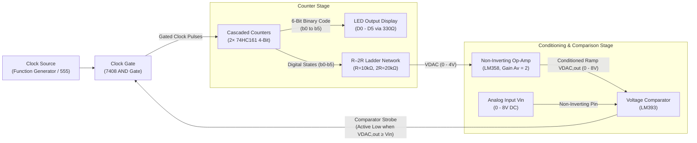
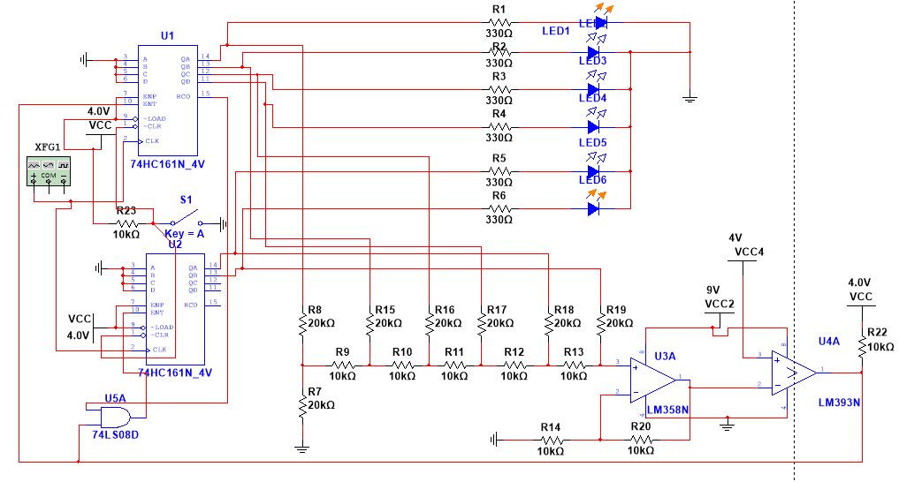
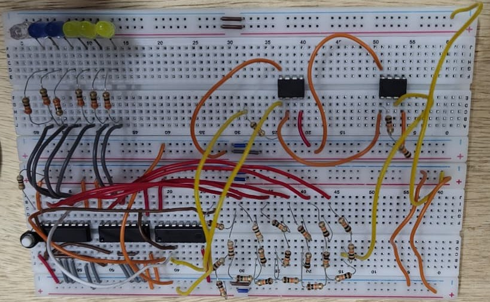

<div align="center">

# ⚡ Design and Implementation of a 6-Bit Analog-to-Digital Converter (ADC)

### **Course:** ECE 2104 — Digital Electronics and Logic Circuits Laboratory  
### **Department of Electronics and Communication Engineering (ECE)**  
### **Khulna University of Engineering & Technology (KUET), Bangladesh**

---

[](LICENSE)
[](https://www.kuet.ac.bd/)
[]()
[]()
[]()
[-success.svg)]()

<p align="center">
  <b>A complete design, simulation, hardware implementation, and performance evaluation of a 6-bit counter-type ADC with a full-scale range (FSR) of 0–8 V.</b>
</p>

</div>

---

## 📑 Table of Contents

- [Project Overview](#-project-overview)
- [Key Specifications](#-key-specifications)
- [System Architecture & Working Principle](#-system-architecture--working-principle)
- [Mathematical Formulation](#-mathematical-formulation)
- [Circuit Schematics & Hardware Prototype](#-circuit-schematics--hardware-prototype)
- [Bill of Materials (Apparatus)](#-bill-of-materials-apparatus)
- [Experimental Results & Verification](#-experimental-results--verification)
- [Error Analysis & Engineering Discussion](#-error-analysis--engineering-discussion)
- [Repository Structure](#-repository-structure)
- [Simulation Guide (NI Multisim)](#-simulation-guide-ni-multisim)
- [Authors & Group Information](#-authors--group-information)
- [References](#-references)
- [License & Security](#-license--security)

---

## 🔍 Project Overview

An **Analog-to-Digital Converter (ADC)** serves as a critical interface between continuous real-world analog signals (such as temperature, pressure, sound, and voltage) and discrete digital computing systems (such as microprocessors, DSPs, and microcontrollers).

This project presents the end-to-end realization of a **6-Bit Counter-Type ADC** operating across an analog input range of **$0\text{ V}$ to $8\text{ V}$**. The conversion process involves:
1. **Quantization:** Partitioning the continuous input voltage span into $2^6 = 64$ discrete quantization levels.
2. **Encoding:** Mapping each quantization step to a unique 6-bit binary code from `000000` to `111111`.
3. **Closed-Loop Feedback:** Utilizing cascaded synchronous counters, an R–2R ladder DAC network, an operational amplifier stage, and a voltage comparator with clock gating.

The system was designed theoretically, modeled and simulated in **NI Multisim 14**, and fabricated on solderless breadboards for physical bench testing and characterization.

---

## ⚙️ Key Specifications

| Parameter | Specification | Notes / Operating Condition |
| :--- | :--- | :--- |
| **ADC Architecture** | Counter-Type (Ramp ADC) | Digital feedback tracking loop |
| **Resolution ($n$)** | **6 Bits** | $N = 2^6 = 64$ quantization steps |
| **Full-Scale Range ($V_{FS}$)** | **$0.0\text{ V}$ to $8.0\text{ V}$** | Unipolar input voltage range |
| **Step Size / Resolution ($\Delta V$)** | **$125\text{ mV / LSB}$** | $\Delta V = \frac{V_{FS}}{2^n} = \frac{8\text{ V}}{64}$ |
| **Output Code Range** | `000000` to `111111` | Decimal $0$ to $63$ |
| **Maximum Nominal Conversion Voltage** | **$7.875\text{ V}$** | Corresponding to code `111111` ($63 \times 125\text{ mV}$) |
| **Clock Frequency ($f_{clk}$)** | $1\text{ Hz}$ to $10\text{ kHz}$ | Set to $1\text{ Hz}$ for visual LED display |
| **Max Conversion Time ($t_{conv}$)** | $64 \times T_{clk}$ | Worst-case conversion at full-scale ($D = 63$) |
| **Supply Voltages ($V_{CC}$)** | $+4.0\text{ V}$, $+9.0\text{ V}$ | Logic rails ($4\text{ V}$), Op-Amp/Comparator rails ($9\text{ V}$) |

---

## 🧠 System Architecture & Working Principle



### Conversion Sequence:
1. **Reset State:** The counters are initialized to zero (`000000`) via a reset pushbutton connected to active-low asynchronous clear inputs.
2. **Counting Phase:** Gated by the 7408 AND gate, each clock pulse increments the dual cascaded 74HC161 counters.
3. **Digital-to-Analog Feedback:** The 6-bit counter outputs drive an **R–2R ladder resistor network** generating an analog staircase ramp $V_{DAC} \in [0\text{ V}, 4\text{ V}]$.
4. **Gain Scaling:** The LM358 operational amplifier boosts the ladder output by $A_v = 2$, producing a scaled ramp $V_{DAC,out} \in [0\text{ V}, 8\text{ V}]$.
5. **Threshold Detection:** The LM393 comparator continuously evaluates $V_{in}$ against $V_{DAC,out}$. The moment $V_{DAC,out} \ge V_{in}$, the comparator output flips LOW, pulling the AND gate input LOW and inhibiting further clock pulses.
6. **Latching Output:** The counter holds its current 6-bit state, illuminated on 6 binary LEDs, representing the quantized digital equivalent of $V_{in}$.

---

## 📐 Mathematical Formulation

### 1. Quantization Levels & LSB Resolution
For an $n$-bit unipolar converter over a full-scale range $V_{FS}$:
```math
N = 2^n = 2^6 = 64 \text{ discrete levels}
```
The voltage increment per Least Significant Bit (LSB) is:
```math
\Delta V = \frac{V_{FS}}{N} = \frac{8.0\text{ V}}{64} = 0.125\text{ V} = 125\text{ mV/LSB}
```

### 2. R–2R Ladder Output Voltage
The analog voltage produced by the 6-bit R–2R resistor ladder is given by:
```math
V_{DAC} = V_{ref} \sum_{i=0}^{5} \frac{b_i}{2^{6-i}} = V_{ref} \left( \frac{b_5}{2} + \frac{b_4}{4} + \frac{b_3}{8} + \frac{b_2}{16} + \frac{b_1}{32} + \frac{b_0}{64} \right)
```
Where $b_5$ is the Most Significant Bit (MSB), $b_0$ is the Least Significant Bit (LSB), and $V_{ref} = 4.0\text{ V}$.

### 3. Operational Amplifier Scaling Gain
To match the ladder output ($0\text{--}4\text{ V}$) to the full input range ($0\text{--}8\text{ V}$), an LM358 non-inverting amplifier is configured with feedback resistor $R_f = 10\text{ k}\Omega$ and ground resistor $R_g = 10\text{ k}\Omega$:
```math
A_v = 1 + \frac{R_f}{R_g} = 1 + \frac{10\text{ k}\Omega}{10\text{ k}\Omega} = 2.0
```
```math
V_{DAC,out} = A_v \times V_{DAC} = 2 \times V_{DAC}
```

### 4. Ideal Digital Code Calculation
The theoretical integer output code $D$ for an arbitrary analog input $V_{in}$ is:
```math
D = \left\lfloor \frac{V_{in}}{\Delta V} \right\rfloor = \left\lfloor \frac{V_{in}}{0.125} \right\rfloor \quad \text{for } 0 \le D \le 63
```

### 5. Conversion Time
For a counter advancing at frequency $f_{clk}$ with period $T_{clk} = \frac{1}{f_{clk}}$, the conversion time required to digitize an input yielding decimal code $D$ is:
```math
t_{conv} \approx \frac{D}{f_{clk}} = D \times T_{clk}
```
- Minimum conversion time: $t_{conv(min)} = 0 \text{ s}$ (for $V_{in} < \Delta V$)
- Maximum conversion time: $t_{conv(max)} = \frac{63}{f_{clk}}$

---

## 🖼️ Circuit Schematics & Hardware Prototype

### Simulation Schematic (NI Multisim 14)
The circuit was laid out and verified in Multisim using real component SPICE models, transient clock excitation, and DC sweep analysis.

<p align="center">
  
  <br>
  <em>Figure 1: Full schematic capture in NI Multisim 14 displaying cascaded 74HC161 counters, R–2R DAC, LM358 buffer, and LM393 comparator.</em>
</p>

### Hardware Breadboard Implementation
The physical circuit was assembled on two dual-bus breadboards, using matched metal-film resistors, decoupled IC power rails, and LED indicators.

<p align="center">
  
  <br>
  <em>Figure 2: Physical hardware implementation tested at the ECE 2104 Laboratory, KUET.</em>
</p>

---

## 🧰 Bill of Materials (Apparatus)

| Sl. | Component / Device | Part / Rating | Quantity | Purpose in Circuit |
|:---:|:---|:---|:---:|:---|
| 1 | **Binary Counter IC** | SN74HC161N (4-Bit Synchronous) | 2 | Cascaded to form the 6-bit synchronous counter stage |
| 2 | **AND Gate IC** | SN7408 / 74LS08D (Quad 2-Input) | 1 | Clock gating control based on comparator feedback |
| 3 | **Operational Amplifier** | LM358N (Dual Low-Power Op-Amp) | 1 | Non-inverting amplifier ($A_v = 2$) scaling DAC voltage |
| 4 | **Voltage Comparator** | LM393N / IL393 (Dual Comparator) | 1 | High-speed comparison between $V_{in}$ and $V_{DAC,out}$ |
| 5 | **Ladder Resistors** | $10\text{ k}\Omega \pm 1\%$ & $20\text{ k}\Omega \pm 1\%$ | 30+ | High-accuracy R–2R resistor ladder DAC network |
| 6 | **Current-Limiting Resistors** | $330\ \Omega \pm 5\%$ | 6 | Protect output indicator LEDs |
| 7 | **Pull-up Resistor** | $10\text{ k}\Omega$ | 1 | LM393 open-collector output pull-up |
| 8 | **LED Indicators** | $5\text{ mm}$ (Red / Yellow / Green / Blue) | 6 | Visual representation of digital output bits ($b_0\text{--}b_5$) |
| 9 | **Reset Push Button** | Normally Open (NO) Momentary | 1 | Manual counter reset trigger |
| 10 | **DC Power Supplies** | Multi-channel benchtop supply | 3 | $+4.0\text{ V}$ (Logic), $+9.0\text{ V}$ (Linear), $0\text{--}8\text{ V}$ ($V_{in}$) |
| 11 | **Function Generator** | Digital Synthesizer ($1\text{ Hz} - 10\text{ kHz}$) | 1 | System clock generation |
| 12 | **Prototyping Boards** | Standard Solderless Breadboards | 2 | Physical circuit wiring |

---

## 📊 Experimental Results & Verification

Ten discrete analog input voltages spanning from $1.16\text{ V}$ up to $7.60\text{ V}$ were applied to both the Multisim simulation model and the physical breadboard prototype.

### Comprehensive Measurement Data Table

| Input $V_{in}$ (V) | Ideal Decimal Code | Measured Binary Output | Multisim Simulated Code | Breadboard Practical Code | Measured Output $V_{out}$ (V) | Code Error ($\Delta D$) | Practical Error (%) |
|:---:|:---:|:---:|:---:|:---:|:---:|:---:|:---:|
| **1.16** | 9 | `001010` | 9 | 9 | 1.21 V | 0 | **0.00%** |
| **2.00** | 16 | `010001` | 17 | 17 | 2.09 V | +1 | **6.25%** |
| **3.01** | 24 | `011001` | 25 | 25 | 3.05 V | +1 | **4.17%** |
| **4.02** | 32 | `100010` | 33 | 34 | 4.16 V | +2 | **6.25%** |
| **5.06** | 40 | `101010` | 41 | 42 | 5.13 V | +2 | **5.00%** |
| **5.35** | 42 | `101101` | 43 | 45 | 5.43 V | +3 | **7.14%** |
| **6.10** | 48 | `110011` | 49 | 51 | 6.24 V | +3 | **6.25%** |
| **6.38** | 51 | `110110` | 52 | 54 | 6.53 V | +3 | **5.88%** |
| **7.31** | 58 | `111101` | 59 | 61 | 7.44 V | +3 | **5.17%** |
| **7.60** | 60 | `111111` | 61 | 63 | 7.67 V | +3 | **5.00%** |

### Intermediate Multisim Simulation Voltages

| Input $V_{in}$ (V) | Simulated Binary Code | Simulated Decimal Code | Simulated DAC Voltage ($V_{DAC}$) | Simulated Op-Amp Output ($V_{DAC,out}$) |
|:---:|:---:|:---:|:---:|:---:|
| 1.16 | `001001` | 9 | 0.625 V | 1.25 V |
| 2.00 | `010001` | 17 | 1.060 V | 2.13 V |
| 3.01 | `011001` | 25 | 1.560 V | 3.13 V |
| 4.02 | `100001` | 33 | 2.060 V | 4.13 V |
| 5.06 | `101001` | 41 | 2.560 V | 5.13 V |
| 5.35 | `101011` | 43 | 2.690 V | 5.38 V |
| 6.10 | `110001` | 49 | 3.060 V | 6.13 V |
| 6.38 | `110100` | 52 | 3.250 V | 6.50 V |
| 7.31 | `111011` | 59 | 3.690 V | 7.38 V |
| 7.60 | `111101` | 61 | 3.810 V | 7.62 V |

---

## 📈 Error Analysis & Engineering Discussion

### Error Summary:
- **Code Error Formulation:** $\text{Code Error} = D_{measured} - D_{ideal}$
- **Percentage Error Formulation:** $\text{Error (\%)} = \left( \frac{|\text{Code Error}|}{D_{ideal}} \right) \times 100\%$
- **Total Signed Error across 10 evaluation points:**
  - **Simulated Net Error:** $+9 \text{ codes}$ ($\frac{9}{389} \times 100\% = \mathbf{2.31\%}$)
  - **Practical Net Error:** $+21 \text{ codes}$ ($\frac{21}{389} \times 100\% = \mathbf{5.40\%}$)

### Root Causes of Deviation in Hardware Implementation:
1. **Resistor Mismatches in R–2R Network:**  
   Standard carbon film resistors with $\pm 5\%$ manufacturing tolerances introduce non-linearities and step-height variations in the reconstructed DAC voltage, leading to cumulative offset errors at higher digital codes.
2. **Operational Amplifier Characteristics (LM358):**  
   The non-inverting amplifier exhibits finite open-loop gain, input offset voltage ($V_{IO} \approx 2\text{--}7\text{ mV}$), and output saturation characteristics near the upper supply rail, causing slight gain compression at higher analog voltages.
3. **Comparator Response & Propagation Delay:**  
   The LM393 requires a finite response time ($t_{pd} \approx 300\text{ ns}$) and input offset voltage ($V_{OS}$) before toggling the pull-up output LOW. At the transition threshold, delay allows the counter to increment by an extra count (+1 code offset).
4. **Breadboard Contact Resistance & Wiring Capacitance:**  
   Solderless breadboards introduce parasitic contact resistances ($0.1\text{--}0.3\ \Omega$ per contact point) and bus-bar voltage drops across ground loops, shifting the effective ground reference for the R–2R ladder and op-amp stage.
5. **Supply Voltage Fluctuations:**  
   Small drifts in the $4.0\text{ V}$ logic supply directly modulate the logic HIGH voltage ($V_{OH}$) of the 74HC161 counter pins, causing reference voltage fluctuations on the R–2R ladder inputs.

---

## 📁 Repository Structure

```
ECE-2104-KUET/
│
├── docs/
│   ├── ECE_2104_Lab_Project_Report.pdf     # Complete 16-page formal academic laboratory report
│   └── details.md                          # Section-by-section breakdown of project report
│
├── simulation/
│   ├── ECE-2104-Project.ms14               # Interactive National Instruments Multisim v14 circuit design
│   └── circuit_schematic_multisim.png      # High-resolution export of the circuit schematic
│
├── hardware/
│   └── breadboard_circuit_setup.jpeg       # High-definition photograph of the breadboard prototype
│
├── .gitignore                              # Comprehensive Git ignore rules (OS, Multisim, IDE)
├── LICENSE                                 # MIT Open-Source License
├── SECURITY.md                             # Security policy & lab electrical safety guidelines
└── README.md                               # Comprehensive project documentation
```

---

## 💻 Simulation Guide (NI Multisim)

To simulate and explore this circuit:

1. **Prerequisites:** Install **National Instruments Multisim** (Version 14.0 or newer).
2. **Open Project:** Launch Multisim and open [`simulation/ECE-2104-Project.ms14`](simulation/ECE-2104-Project.ms14).
3. **Set Input Voltage:** Double-click on the DC voltage source `V1` / $V_{in}$ and select your desired test value ($0.0\text{ V} \le V_{in} \le 8.0\text{ V}$).
4. **Run Simulation:** Click the green **Run** button or press <kbd>F5</kbd>.
5. **Reset Counter:** Press key <kbd>A</kbd> or click switch `S1` to clear the counter to `000000`.
6. **Analyze Output:**
   - Observe the 6 probe LEDs (`LED1` through `LED6`).
   - Monitor the DAC ramp on the oscilloscope connected between $V_{DAC,out}$ and GND.

---

## 👥 Authors & Group Information

**Group A-10**  
Department of Electronics and Communication Engineering (ECE)  
**Khulna University of Engineering & Technology (KUET)**  
Khulna-9203, Bangladesh

| Name | Student Roll | Role |
| :--- | :---: | :--- |
| **Kankon Mondal** | `2409021` | Circuit Design, Multisim Simulation, Hardware Testing & Documentation |
| **Mst. Naznin Aktar** | `2409020` | Mathematical Calculations, Hardware Assembly & Result Analysis |

---

## 📚 References

1. A. S. Sedra and K. C. Smith, *Microelectronic Circuits*, 7th ed., Oxford University Press.
2. Texas Instruments, *SN74HC161 Synchronous 4-Bit Binary Counter Datasheet*, Revised Dec 2022.
3. Texas Instruments, *LM358 Dual Operational Amplifiers Datasheet*, Revised Sep 2023.
4. Texas Instruments, *LM393 Dual Differential Comparators Datasheet*, Revised Jan 2023.
5. National Instruments, *NI Multisim User Guide and Component Reference*, NI Corporation.
6. Department of ECE, KUET, *ECE 2104: Digital Electronics and Logic Circuits Laboratory Manual*, 2026.

---

## 📜 License & Security

- This project is open-source under the [MIT License](LICENSE).
- For laboratory electrical safety instructions and vulnerability reporting, see [SECURITY.md](SECURITY.md).
